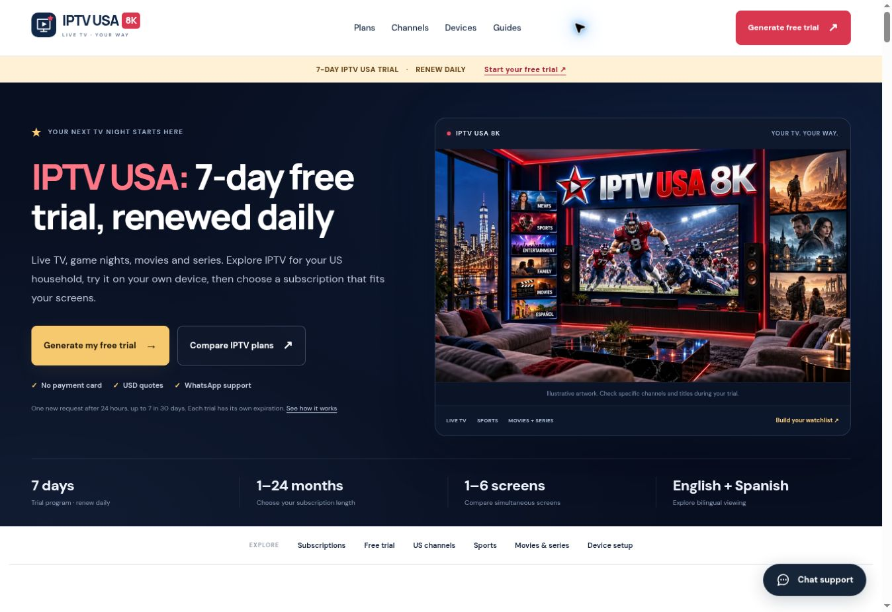

# USA GitHub and Cloudflare migration

Verified November 1, 2026.

## Source and hosting

- GitHub: https://github.com/briouel123moh-cloud/IPTV-USA-8K
- Public website: https://iptv-usa-8k.pages.dev/
- Cloudflare Pages project: `iptv-usa-8k`, BRIOUEL123MOH account.
- Production branch: `main`, automatic production deployment enabled.
- Build: `npm run build`, output `dist`, Node 24.
- Initial complete source commit: `b27009f900e1e0df0d932c39ebf4ee50cd85528a`.
- Initial successful Git deployment: `99d054f9-ef83-46f7-8175-25ea828b1485`; clone, build and deploy stages succeeded at 19:50 UTC.

Restored the previous source at `1b84664330febd63169eb7cd19c9923ac73d3a3c` and copied its tracked application files into this standalone repository. Removed the ChatGPT Sites hosting identity from this destination. The earlier private review is retained as historical material, not the deployment target.

All 21 pages, original image assets, 42 duration/screen quote configurations and the existing trial integration are retained. Belgium was added to the regional footer alongside Canada, Emerald, Ireland Subscription and Suomi. Emerald's own website was not changed.

## Live verification

- The public Cloudflare homepage renders with its USA imagery and self canonical.
- Its embedded form loads with IPTV USA 8K branding, the new Pages privacy URL and WhatsApp `212631479723`.
- Selecting three screens updates the 12-month request to the short message `Hi, IPTV USA 8K: 12 months, 3 screens. Price?` and the correct support number.
- The footer contains the Belgium destination `https://iptv-belgique-8k.com/`.
- Build and all 15 tests passed, covering routes, links, metadata, structured data, images, trial configuration, preview indexing controls and plan requests.
- No real trial account, CAPTCHA or outbound support message was submitted during verification.

## Trial service migration

The existing shared Worker's `usa` profile now lists `https://iptv-usa-8k.pages.dev` first and retains the earlier Sites origin for the historical review. Making Pages primary also updates the widget's privacy destination. All 25 bindings, 12 secrets, other regional profiles and unrelated Worker settings were preserved and verified after the update. The source stores only public configuration; provider credentials remain on the Worker.

Legacy trial registration documentation describes the original rollout. This record and the current source configuration describe the current hosting target.

## Search launch status

The website is publicly accessible without login. `PUBLIC_INDEXABLE=false` deliberately keeps the temporary Pages hostname out of search while an owned USA domain is pending. Its robots meta/header use `noindex,follow`, and the preview sitemap has no indexable entries. This is separate from public accessibility.

Once the owned domain is connected, follow the README's domain launch steps: update canonical origin, trial origin and privacy destination; enable indexing; rebuild; run the launch gate; verify redirects and trial embedding. Indexable builds generate 21 canonical sitemap URLs. No ranking position or indexing deadline is guaranteed.

No provider secrets, customer records, authentication tokens or local environment files are included in source or deployed assets.
