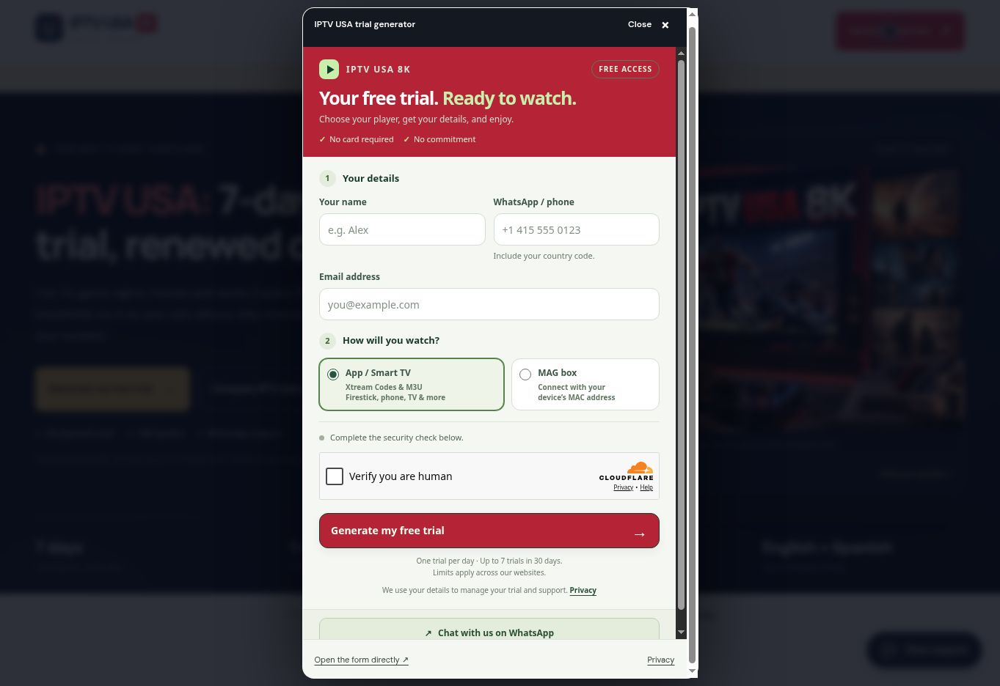

# USA GitHub, Cloudflare and custom-domain launch

Verified November 1, 2026.

## Current production

- Website: https://iptv-usa-8k.com/
- Repository: https://github.com/briouel123moh-cloud/IPTV-USA-8K
- Pages project: `iptv-usa-8k`, BRIOUEL123MOH account.
- Runtime source: `edd7feff61d75f9d6411b751eaa647ae3d9a96de`.
- Successful production deployment: `ab161a02-afa4-4a64-ba68-356174c1cca6`, completed at 20:49 UTC.
- Both apex and www custom domains are active. The zone and Universal SSL certificate are active.
- Production build: Node 24, `npm run build`, output `dist`.

`wrangler.jsonc` is the authoritative Pages build configuration. It now contains the production HTTPS origin and `PUBLIC_INDEXABLE=true`; preview configuration explicitly keeps indexing disabled. The first domain build revealed that dashboard variables were not loaded when the Wrangler file contained no variables. This was corrected in source and verified in the succeeding Cloudflare build log: 21 sitemap URLs, indexable production, Node 24.22.1.

## Verified browser behavior

- Homepage and free-trial page use their own `https://iptv-usa-8k.com` canonical URLs and `index,follow` robots metadata, with expanded image/snippet preview directives.
- The temporary launch-preview footer label is gone.
- The live sitemap index points to https://iptv-usa-8k.com/sitemap.xml.
- The live sitemap contains exactly 21 page entries, image URLs and maintained modification dates. No Pages hostname remains in its content.
- The live robots.txt allows crawling and references the correct sitemap index.
- The embedded trial form loads inside the custom domain, shows USA branding, links Privacy to https://iptv-usa-8k.com/privacy/ and uses WhatsApp 212631479723.
- The pricing selector and short WhatsApp messages were verified during the preceding Pages release; the custom-domain launch preserves those application files.
- No real trial, CAPTCHA or support message was submitted during QA.

Build, all 16 tests and the launch gate passed using the exact variables read from the Wrangler production configuration. Tests cover routes, internal links, metadata, structured data, imagery, trial integration, quote combinations and host-specific noindex headers.

## Canonical redirects

Two permanent redirects now lead to https://iptv-usa-8k.com/:

- `www.iptv-usa-8k.com/`
- `iptv-usa-8k.pages.dev/`

Browser checks of `/plans/?utm_source=canonical-check&device=firestick` confirmed that both source hosts preserve the path and query string. The Bulk Redirect entries use subpath matching and preserve suffix/query, with `include_subdomains=false`, so deployment preview subdomains are excluded.

- Redirect list: `4da380b75f0e45eca6271a9814ae9319`
- Ruleset: `d87a9530d990479e9c0acb96aba52c5e`
- Enabled rule: `468ca8b2e10242579b7b2754f9a2de7d`

Pages hostname patterns also retain host-specific noindex headers in the generated artifact. The custom domain's global header block does not include noindex. No unrelated redirect configuration was changed. Local network HEAD requests were blocked by the execution environment proxy; redirect and page behavior were therefore verified through the browser, with configuration readback from Cloudflare.

## Trial-service origins

The shared Worker's existing USA profile now contains these origins, in order:

1. https://iptv-usa-8k.com
2. https://www.iptv-usa-8k.com
3. https://iptv-usa-8k.pages.dev
4. https://iptv-usa-8k.tart-lemon-7570.chatgpt.site

The first origin supplies the widget privacy destination. All 25 bindings, 12 secrets, other regional profiles and unrelated settings were preserved and verified. Provider credentials stay on the Worker. Existing daily renewal and shared quotas remain unchanged.

## Earlier migration and ongoing deployment workflow

The source was recovered from the earlier private Sites revision `1b84664330febd63169eb7cd19c9923ac73d3a3c`, then published into this standalone GitHub repository. The first successful Git-backed Pages deployment was `99d054f9-ef83-46f7-8175-25ea828b1485` at source `b27009f900e1e0df0d932c39ebf4ee50cd85528a`. The earlier private Sites review is historical, not the current deployment target. Legacy trial-registration documentation records that original rollout.

The Cloudflare automatic-deployment flag is enabled, but the repository's installed-apps view does not list Cloudflare and the tested documentation push did not trigger a build. Current releases have been explicitly triggered through the Pages API, which successfully clones this GitHub repository. Future updates need an explicit Pages Git build until the Cloudflare GitHub app is connected. No additional app permissions or credentials were created.

The site retains 21 pages, eight guides, 36 FAQs, original imagery and 42 duration/screen quote configurations. Regional links include Belgium, Canada, Emerald, Ireland Subscription and Suomi. Emerald's website was not changed. No provider secrets, customer records, authentication tokens or local environment files are committed. Search indexing is enabled; Google indexing, rich-result display and ranking positions remain search-engine decisions.
